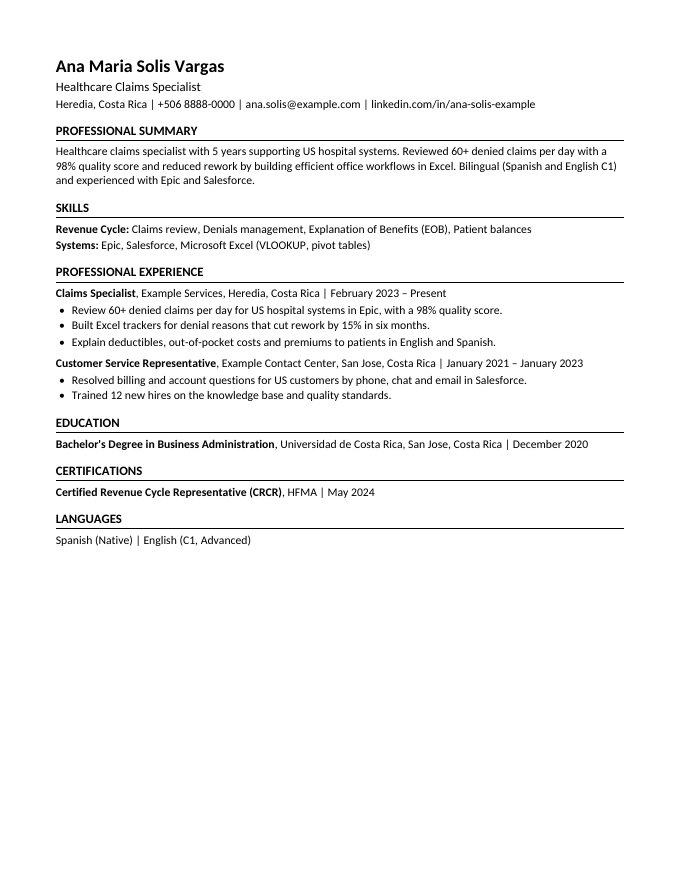
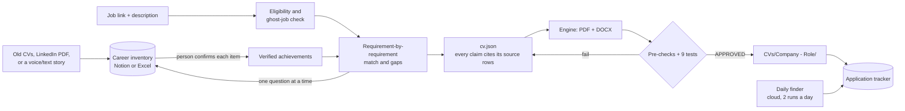

<!-- Copyright 2026 Johel Gomez Rojas. Part of CV Factory. Licensed under the Apache License, Version 2.0 (see LICENSE and NOTICE). Do not remove this notice. -->

# CV Factory

[](https://github.com/xJDevs/cv-factory/actions/workflows/engine.yml)

**An AI-agent workflow that turns a verified career history into tailored, ATS-safe English CVs, and refuses to deliver any CV that fails 9 automated tests.**

Paste a job link and description into a conversation with your AI agent. CV Factory checks whether you can actually take the job from where you live, matches your experience against every requirement, asks you about the gaps one question at a time, and builds a PDF and a DOCX in which **every sentence can be traced back to a fact you confirmed**. Then it tests the files the way applicant tracking systems, résumé parsers and AI screeners read them. A daily finder can also look for vacancies for you twice a day and leave them in your tracker.

It never applies for you and never invents anything.

Designed and built by **Johel Gomez Rojas** — software development, systems and automation with AI agents. It is used every day in the author's own job search.



*A CV generated for a fictional person (Ana María Solís Vargas). Files and test report: [`engine/example/output/`](engine/example/output/).*

## The problem

- Hundreds of people apply to each remote role, and tailoring every CV by hand takes an hour or more.
- Recruiters and AI screeners now check requirement by requirement and look for evidence. What is not written does not exist.
- The common failures are not about style. Text comes out of the PDF scrambled, the layout breaks the parser, there are ligatures and odd characters, or dates and titles get separated. And AI writing tools happily invent experience.
- Many remote vacancies quietly exclude your country, are already closed, or are not real.

## How it works



1. **Onboarding.** The agent interviews you, builds your career inventory from what you give it (old CVs, a LinkedIn PDF, or just telling your story), and verifies every achievement with you. It also creates your Notion workspace (or an Excel workbook), proposes target roles with a fit % and gaps, and sets up job sources for your country.
2. **One conversation per vacancy.** Eligibility → match table → questions about gaps → `cv.json` with sources → generate → tests → save → record in the tracker.
3. **Daily finder (optional, Notion).** A scheduled cloud task searches free job sources, discards vacancies you cannot take or that look like ghost jobs, scores the rest against your verified inventory, and writes the best ones to your tracker. It sends a phone alert for strong matches.
4. **LinkedIn kit.** It builds your whole profile, ready to copy, from verified data, plus one-click searches of the last 24 hours, because LinkedIn may not be read by robots.

## The guarantees

| Guarantee | How it is enforced |
|---|---|
| Nothing invented | Every summary sentence, bullet, job and skill in `cv.json` lists the inventory rows it comes from. The engine's pre-check refuses to build a CV if a source is missing, unknown, or an unverified achievement. |
| Complete, live reading | The snapshot records how many rows each database has. If the reading skipped a row or did not open a page, the engine stops. |
| Readable by machines | 9 tests on every file (below). A CV is delivered only on `APPROVED`. |
| Honest fit | Requirement-by-requirement scoring. Required items weigh double, and the fit is capped at 70 % without experience in the role's core area. The agent reports the fit; the person decides. |
| No automation abuse | It never applies, creates accounts or contacts anyone. It never reads LinkedIn or any site that forbids robots. |

## The 9 tests

| # | What it checks |
|---|---|
| Pre | Required data, allowed characters, valid dates. Every claim traceable to verified inventory rows. |
| 1 | Fonts embedded with a Unicode map, no Type 3 fonts (`pdffonts`) |
| 2 | Four different PDF readers (pdftotext, pdfminer, pdf.js, pdfium) recover ≥ 99.5 % of the words, with no forbidden characters |
| 3 | No spaced-out letters, no words split by end-of-line hyphens |
| 4 | Reading order: sections in order, contact details in the first lines, title–company–dates kept together |
| 5 | The open-source OpenResume parser extracts name, contact, jobs and education (an education entry without an English school or degree word it recognizes is only noted; tests 4 and 6 verify it) |
| 6 | Two AI agents with **no context** read the PDF and the plain text and copy name, contact, jobs, dates, education and languages correctly |
| 7 | Metadata (title, author, language), size under 1 MB, at most 2 pages, file name |
| 8 | The DOCX has no tables, text boxes or header/footer text; converted to PDF with LibreOffice it passes tests 1–4 |
| 9 | No accents or ñ anywhere in an English CV, including metadata and file name ("San Jose") |

Each rule traces back to research: how ATS parse and rank, what AI screeners do, CV format conventions, and experiments with five PDF libraries. See [`docs/research/`](docs/research/).

## Design decisions worth noting

- **HTML + CSS → Chromium for the PDF, python-docx for the DOCX.** Chosen after experiments with LaTeX (pdfLaTeX, XeLaTeX, LuaLaTeX) and other generators. Ligatures, glyph mapping and reading order failed in ways that broke text extraction ([research doc 05](docs/research/05-generating-pdf-and-docx.md)).
- **Carlito font** (metric-compatible with Calibri, OFL), embedded. Words with hyphens are never split across lines, because pdfium reads that break as a broken character.
- **The data model separates facts from wording.** Achievements keep the person's own description, a CV-ready English version, the metric, the context (STAR) and a Verified flag. The CV uses only verified rows.
- **Agent-agnostic.** `CLAUDE.md` holds the instructions and `AGENTS.md` maps them for Codex, Gemini, Cursor and others. The engine is plain Python and Node, run from the command line.
- **Cross-platform.** It works on macOS, Linux and Windows 10/11: one Python setup script, programs found in PATH or in their usual install folders, UTF-8 everywhere, and an integrity check that ignores line endings. Tested on macOS; Windows and Linux are covered by the CI workflow (`.github/workflows/engine.yml`).
- **Notion is read through database views, not SQL queries.** Notion limits SQL query usage on its plans, and the views give the same rows without that limit.
- **Integrity check.** `engine/MANIFEST.sha256` fingerprints the core files. Setup warns if someone changed them, because users are encouraged to expand the project but not to modify the engine.

## Use it for yourself (no commands needed)

1. Read the [user guide](docs/user-guide.md) (10 minutes) and the [disclaimer](DISCLAIMER.md).
2. Download this repository (green **Code** button → **Download ZIP**, or `git clone`), unzip it and put the folder on your Desktop as **`cv-factory`**.
3. Open that folder in Claude Code (or another AI agent) and write: *"Hi, set me up."* Use the most capable model you have.

That's it. The AI runs the onboarding (`setup/onboarding.md`): it checks your computer, tells you what to install if something is missing, and installs the rest itself, then builds your inventory, your Notion workspace (or Excel workbook) and, if you want, the daily finder. You never have to type the commands below.

## Quick check for developers

Optional: this only proves that the engine works on your machine. It installs the engine and runs the 9 tests on the fictional example CV, without any personal data.

Requirements: macOS, Linux or Windows 10/11, with Python 3.10+, Node, poppler, LibreOffice and git. `engine/setup.py` installs the rest locally and says what is missing.

| | macOS (Homebrew) | Linux (apt) | Windows (winget, PowerShell) |
|---|---|---|---|
| Python | `brew install python` | `sudo apt install python3 python3-venv` | `winget install -e --id Python.Python.3.13` |
| Node | `brew install node` | `sudo apt install nodejs npm` | `winget install -e --id OpenJS.NodeJS.LTS` |
| poppler | `brew install poppler` | `sudo apt install poppler-utils` | `winget install -e --id oschwartz10612.Poppler` |
| LibreOffice | `brew install --cask libreoffice` | `sudo apt install libreoffice-writer fonts-crosextra-carlito` | `winget install -e --id TheDocumentFoundation.LibreOffice` |
| git | `xcode-select --install` | `sudo apt install git` | `winget install -e --id Git.Git` (Claude Code on Windows needs it) |

On Windows, open a new terminal after installing. If winget cannot install poppler, see `engine/README.md` (release zip + `CVF_POPPLER_BIN`).

macOS / Linux:

```bash
git clone https://github.com/xJDevs/cv-factory.git ~/Desktop/cv-factory && cd ~/Desktop/cv-factory
python3 engine/setup.py                   # must end with READY
mkdir -p my-data/reads/example-check      # a copy, so the example itself is never overwritten
cp engine/example/output/*.* my-data/reads/example-check/
engine/.venv/bin/python engine/scripts/cv.py test \
  engine/example/cv-example.json \
  --snapshot engine/example/snapshot-example.json \
  --out my-data/reads/example-check       # → APPROVED
```


Windows (PowerShell). The commands find your real Desktop on their own, even when OneDrive backs it up (then it is `C:\Users\<you>\OneDrive\Desktop`):

```powershell
git clone https://github.com/xJDevs/cv-factory.git "$([Environment]::GetFolderPath('Desktop'))\cv-factory"
cd "$([Environment]::GetFolderPath('Desktop'))\cv-factory"
py engine\setup.py                                   # must end with READY
New-Item -ItemType Directory -Force my-data\reads\example-check
Copy-Item engine\example\output\*.* my-data\reads\example-check\
engine\.venv\Scripts\python.exe engine\scripts\cv.py test engine\example\cv-example.json `
  --snapshot engine\example\snapshot-example.json --out my-data\reads\example-check   # → APPROVED
```

## Project structure

```
CLAUDE.md / AGENTS.md   instructions for the AI agent
engine/                 CV engine: template, scripts, 9 tests, fictional example
setup/                  onboarding, Notion blueprint, Excel spec, finder rules and prompt, LinkedIn guide
docs/                   user guide, how to expand safely, research
my-data/  CVs/          your private data and your CVs (created on first use, never committed)
```

## Tech

Python (Jinja2, Playwright/Chromium, pikepdf, python-docx, pdfminer.six, pypdfium2, openpyxl), Node (pdf.js, tsx), poppler, LibreOffice, Notion MCP, Claude Code (agents, subagents, scheduled cloud routines).

## License and credit

Apache License 2.0. See [`LICENSE`](LICENSE) and [`NOTICE`](NOTICE). You may use, share and modify it. Redistributions must keep the NOTICE and the author notices in each file. Read the [disclaimer](DISCLAIMER.md): only true information, you are responsible for your AI usage costs, no guarantees.

© 2026 Johel Gomez Rojas.
